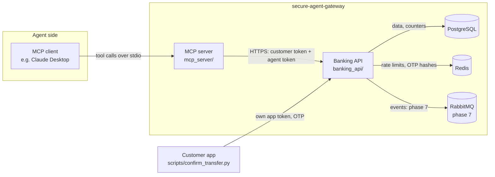

# Architecture

## Components

The MCP server is the only thing the AI ever talks to. The banking API is
the only thing that ever touches data. The customer app's confirmation
path never passes through the MCP server or the agent at all - it is a
separate channel the agent has no tool for.

## Request flow: a transfer

1. The customer asks the assistant to send money. The LLM decides to call
   `initiate_transfer` with structured arguments - it never writes SQL or
   calls the banking API directly.
2. The MCP server attaches the customer's delegated token (no
   `transfers:confirm`) and its own agent token, plus a fresh correlation
   ID, and calls `POST /transfers`.
3. The banking API verifies both tokens, intersects their scopes,
   resolves `from_account_alias`/`beneficiary_alias` against the
   *authenticated* customer_id (never a request parameter), and applies
   the business rules in `rules.py`.
4. A `pending_confirmation` transfer is created under its `Idempotency-Key`,
   an OTP is generated and sent to `var/sms_outbox.log` (masked phone), and
   the API returns a status - never the OTP - to the agent.
5. The customer reads the OTP from their own phone/app and confirms via
   `scripts/confirm_transfer.py`, which logs in fresh as the customer (no
   agent token at all) and calls `POST /transfers/{id}/confirm`.
6. Only on a correct, unexpired OTP does the API debit the account, post a
   transaction, and mark the transfer `completed` - all in one database
   transaction.
7. Every step above - allowed or denied - writes one row to the
   hash-chained audit log (`audit.py`).

## Identity and tokens

Two tokens travel on every call to the banking API:

- **Customer token** (`Authorization: Bearer <jwt>`) - who the action is
  *for*. A **delegated** customer token (obtained via the token-exchange
  grant, `make login`) is the only one the MCP server ever holds; it
  excludes `transfers:confirm` by construction.
- **Agent token** (`X-Agent-Token: <jwt>`) - who is *acting*. Issued by
  client-credentials grant to the `assistant-v1` agent identity, whose
  registered scopes never include `transfers:confirm` either.

**Effective scopes = customer scopes ∩ agent scopes.** Both sets have to
grant a capability before it's usable - neither token alone is enough.
See `docs/security.md` for the full token-exchange explanation.

## Resilience (MCP client -> banking API)

- Explicit timeouts (connect 2s, read 5s) on every call.
- GET requests retry up to 3 times with exponential backoff and jitter;
  4xx responses are never retried (they're an answer, not an outage).
- `POST /transfers` retries only ever reuse the *same* `Idempotency-Key`,
  so a retried request cannot create a duplicate transfer.
- A circuit breaker (`pybreaker`) opens after 5 consecutive infrastructure
  failures for 30 seconds, failing fast with a clear
  "banking service temporarily unavailable" tool error instead of piling
  up retries against a dependency that's already down.

## Events (phase 7, optional)

`POST /transfers/{id}/confirm` writes an `outbox` row in the same
transaction as the completed transfer (the outbox pattern: the business
change and the outgoing event either both commit or neither does).
`workers/outbox_relay.py` polls `outbox` for unpublished rows and
publishes `transfer.completed` to the `banking.events` topic exchange with
publisher confirms, then marks the row published.
`workers/notifications.py` consumes with manual acks and a prefetch limit,
and is idempotent by `transfer_id` (a unique constraint on
`notifications.transfer_id`), so redelivering the same message twice
creates exactly one notification. After repeated failures a message is
dead-lettered to `banking.events.dlq` rather than blocking the queue.

This is **at-least-once delivery plus an idempotent consumer**, which
together give effectively-once processing without needing exactly-once
delivery from the broker itself.

## Why this design, not something more "real"

A real core banking integration would sit behind SOAP or a proprietary
protocol, use mutual TLS between internal services, and issue tokens from
a real IdP with Authorization Code + PKCE. None of that changes where the
actual security work happens: at the boundary where an untrusted caller
(here, an LLM) asks a trusted system to do something. This project keeps
everything else as simple as possible - mock data, one Postgres instance,
one Redis instance - so that boundary is the only complicated thing in the
repository.
